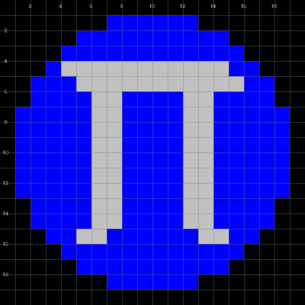

# pico



A 2D graphics library for [Atmos][atmos], built on [pico-sdl](c/).

- [`pico.atm`](pico.atm): the Atmos binding and environment (its header
  documents the API).
- [`pico-atmos`](pico-atmos): builds and runs an Atmos program with the
  binding.
- [`doc/guide.md`](doc/guide.md): a tutorial;
  [`doc/api.md`](doc/api.md): the reference.
- [`tst/`](tst/): tests of the binding (`ATMOS=/path/to/atmos tst/run.sh`).
- [`c/`](c/): the C library (`pico-sdl`), with its tests and documentation.
- Games:
    - [`exs/birds/`](exs/birds/): a tutorial in 11 steps
    - [`exs/rocks/`](exs/rocks/): a spaceship shooter for 2 players
    - [`exs/storm/`](exs/storm/): a port of `ceu-sdl-storm`

[atmos]: https://github.com/ia-atmos/lang

# Run

```
sudo apt-get install libsdl2-dev libsdl2-image-dev libsdl2-mixer-dev libsdl2-ttf-dev libsdl2-gfx-dev
ATMOS=/path/to/atmos ./pico-atmos tst/env.atm
```

```
spawn {
    loop on :draw {
        pico.output.draw.rect ['%', x=0.5, y=0.5, w=0.5, h=0.5]
    }
}
await(:key.dn)
```

# C library

```
sudo apt-get install libsdl2-dev libsdl2-image-dev libsdl2-mixer-dev libsdl2-ttf-dev libsdl2-gfx-dev
cd c/
./pico-sdl tst/cross.c
make tests
```

See [`c/README.md`](c/README.md).
