# Guide

1.  [Introduction](#1-introduction)
2.  [Initialization](#2-initialization)
3.  [Basic Drawing](#3-basic-drawing)
4.  [Positioning: Modes & Anchors](#4-positioning-modes--anchors)
5.  [Advanced Views](#5-advanced-views)
6.  [Events](#6-events)
7.  [Layers](#7-layers)
8.  [Expert Mode](#8-expert-mode)
9.  [Auxiliary Functions](#9-auxiliary-functions)
10. [Extras](#10-extras)

## 1. Introduction

`pico-atmos` is a graphics library for 2D games and applications, written for
the programming language [Atmos](https://github.com/ia-atmos/lang).
It is designed around 4 groups of APIs:

- `pico.output.*`: draw shapes and layers; play sounds and videos.
- `pico.input.*`: handle events, such as time passing and key presses.
- `pico.get.*` and `pico.set.*`: manage internal library state,
    such as current drawing color, and window dimensions.
- `pico.layer.*`: structure graphics in hierarchical scenes.

This guide is a walk-through of `pico-atmos`.
It is not meant to be exhaustive.
Consult the [API](api.md) for completeness.

Atmos has no interactive prompt: a program is a file, which the script
[`pico-atmos`](../pico-atmos) builds and runs.
Save the next program as `hello.atm` in this directory (`doc/`):

```
include "../pico.atm"       ;; path relative to the program

pico.open()
pico.output.draw.rect [ '%', x=0.5, y=0.5, w=0.5, h=0.5 ]
pico.input.loop()           ;; keeps the window until it is closed
```

Then, from the command line, execute `pico-atmos` with the file:

```bash
$ ../pico-atmos hello.atm
```

The script requires the Atmos compiler, either as `atmos` in the `PATH`, or as
set in the environment variable `ATMOS`.

A program starts with an `include` of the file [`pico.atm`](../pico.atm), with
a path relative to the program itself.
A program terminates with its last line, which also closes the window.
For this reason, the example ends with a call to `pico.input.loop`, which waits
until we close the window.

In the rest of this guide, we only show the lines in between:

- The examples assume a program in this directory, such that `../pico.atm`
  and the files in `../c/res/` are found.
- The examples continue each other: the state of an example carries over to the
  next one, until an example restarts `pico-atmos`.
- To follow the examples step by step, you may insert a
  `pico.input.event('key.dn')` after a step, which waits for a key press.

If you come from Lua, note that Atmos writes tables with brackets (`[...]`),
starts indexes at `0`, comments with `;;`, declares variables with `val`
(immutable) and `var` (mutable), and assigns with `set`.
The manual of Atmos lists all
[differences](https://github.com/ia-atmos/lang).

## 2. Initialization

### 2.1. Open

To initialize `pico-atmos`, we call `pico.open`:

<table>
<tr><td><pre>
pico.open()
</pre>
</td><td>
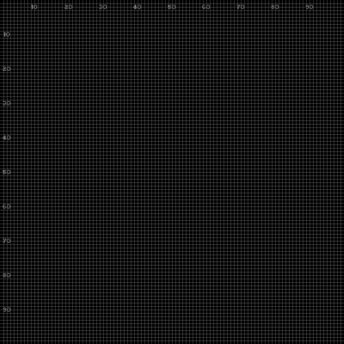
</td></tr>
</table>

We immediately see a window of `100x100` **logical pixels**, built on top of
`500x500` **physical pixels** divided in small `5x5` rectangles.

In the context of `pico-atmos`, we use the term **world** to designate the
logical layer, and **window** for the physical layer.

By default, note that `pico-atmos` conventionally exhibits the grid and
coordinate labels to aid development with visual inspection.
You may click the image to zoom in.

The call also accepts a table with the initial window title, fullscreen
state, and visibility, as in `pico.open [ title="Hello" ]`.

### 2.2. Configure

To configure the window and the world views, we use `pico.set.scene` on the
appropriate layer:

<table>
<tr><td><pre>
pico.set.layer(pico.layer.window())
pico.set.scene [ dim=[ '!', w=200, h=200 ] ]
pico.set.layer(pico.layer.world())
pico.set.scene [ dim=[ '!', w=200, h=200 ] ]
</pre>
</td><td>
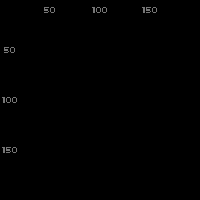
</td></tr>
</table>

The character `'!'` indicates a dimension in "raw mode".
We discuss [#Positioning Modes](#4-positioning-modes--anchors) further.

The `window` and `world` are pre-defined layers, which we can manipulate
independently.
The calls `pico.layer.window()` and `pico.layer.world()` evaluate to them.
We discuss [#Layers](#7-layers) further.
Using the same dimensions for both makes the grid disappear, since the pixel
size becomes `1x1`.

We could also use the simpler `pico.set.dim` to set both views at the same
time:

<table>
<tr><td><pre>
pico.set.dim [ '!', w=200, h=200 ]
</pre>
</td><td>

</td></tr>
</table>

*(The image is the same as before.)*

### 2.3. Close

In the end of the session, we should call `pico.close` to properly finalize
`pico-atmos`:

<table>
<tr><td><pre>
pico.close()
</pre>
</td><td>
*(no image)*
</td></tr>
</table>

If the program terminates with `pico-atmos` still open, then it is closed
automatically.

Then, we can restart `pico-atmos` by calling `pico.open` again:

<table>
<tr><td><pre>
pico.open()
</pre>
</td><td>

</td></tr>
</table>

We can see that grid and dimensions are now reset to default.

## 3. Basic Drawing

To ease prototyping, drawing operations in `pico-atmos` take immediate effect.

### 3.1. Shapes

To draw a single pixel, we call `pico.output.draw.pixel`:

<table>
<tr><td><pre>
pico.output.draw.pixel [ '!', x=50, y=50 ]
</pre>
</td><td>
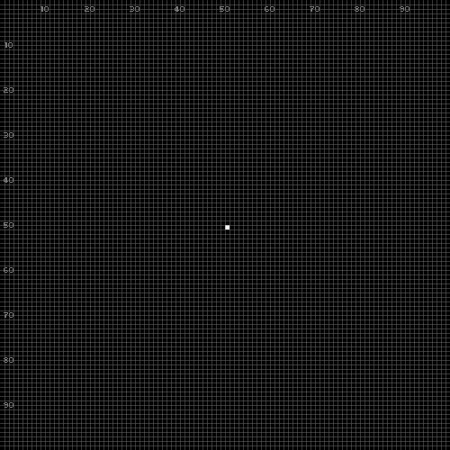
</td></tr>
</table>

By default, drawing operations target the world layer.
This way, the pixel is visible for inspection, occupying a physical `5x5`
square.

To draw a rectangle, we call `pico.output.draw.rect`:

<table>
<tr><td><pre>
pico.output.draw.rect [ '!', x=20, y=20, w=30, h=30 ]
</pre>
</td><td>
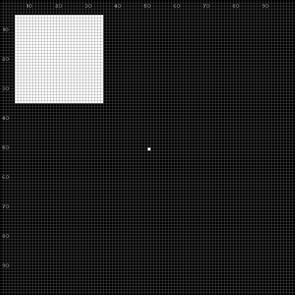
</td></tr>
</table>

The table specifies a rectangle at position `(20,20)` with size `30x30`.
With the aid of the tick marks, we can see that the rectangle is actually
**centered** at the given position.

Unlike most graphics libraries, by default `pico-atmos` anchors an object at
its center.
We discuss [#Anchors](#4-positioning-modes--anchors) further.

Note that `pico-atmos` retains both shapes on the screen, i.e., drawing
operations are cumulative.

Other drawing operations include `pico.output.draw.line`,
`pico.output.draw.poly`, and `pico.output.draw.oval`.

### 3.2. Colors

To clear the screen, we call `pico.output.clear`:

<table>
<tr><td><pre>
pico.output.clear()
</pre>
</td><td>

</td></tr>
</table>

Now the pixel and rectangle are gone.

By default, `pico-atmos` uses black to clear the screen and white to draw
shapes.

To pick different colors, we use `pico.set.effect` and `pico.set.pencil`
passing the `color` attribute:

<table>
<tr><td><pre>
pico.set.effect [ color='yellow' ]  ;; background
pico.set.pencil [ color='red'    ]  ;; shapes
pico.output.clear()
pico.output.draw.rect [ '!', x=50, y=50, w=50, h=50 ]
</pre>
</td><td>
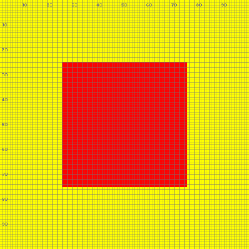
</td></tr>
</table>

In the example, we set the background color as yellow, and the drawing color
for shapes as red.
Then, we clear the screen and draw a centered rectangle.

Note that a `set` has no immediate effect on the screen, and only affects
further operations.

Colors can also be specified as numbers or tables:

<table>
<tr><td><pre>
pico.set.pencil [       ;; 0xRRGGBB[AA]
    color = 0xCCCCCC
]
pico.output.draw.pixel [ '!', x=26, y=26 ]
pico.set.pencil [       ;; percent mode '%' (0.0-1.0)
    color=[ '%', r=0, g=0.5, b=0, a=0.5 ]
]
pico.output.draw.pixel [ '!', x=73, y=73 ]
</pre>
</td><td>
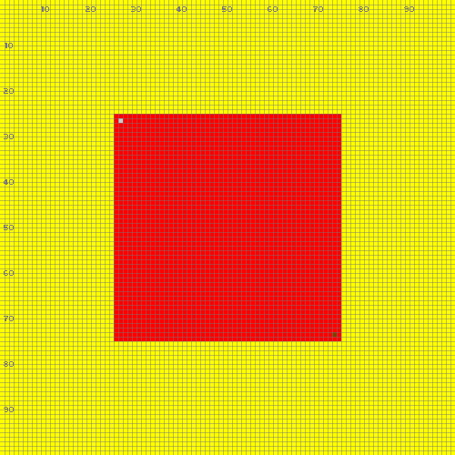
</td></tr>
</table>

Let's restart `pico-atmos` for the next examples:

<table>
<tr><td><pre>
pico.close()
pico.open()
</pre>
</td><td>

</td></tr>
</table>

### 3.3. Text, Image and Pixmap

To write a text, we call `pico.output.draw.text`:

<table>
<tr><td><pre>
pico.output.draw.text("Hello", ['!', x=50, y=33, h=30])
pico.set.pencil [ font='../c/res/DejaVuSans.ttf' ]
pico.output.draw.text("Hello", ['!', x=50, y=66, h=30])
</pre>
</td><td>
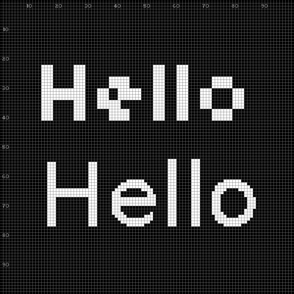
</td></tr>
</table>

*(The [font](../c/res/DejaVuSans.ttf) is part of the repository.)*

We first draw `Hello` at the top using the default built-in font.
Then, we switch to a new font and draw `Hello` again at the bottom.

Note that `pico-atmos` preserves the correct text aspect ratio when we omit the
width `w`.

The field `font` also accepts a font loaded with `pico.font.load(path)`, or
`false` to switch back to the built-in font:

```
val font = pico.font.load('../c/res/DejaVuSans.ttf')
pico.set.pencil [ font=font ]       ;; same effect as the path
pico.set.pencil [ font=false ]      ;; back to the built-in font
```

To draw an [image](../c/res/open.png), we call `pico.output.draw.image`:

<table>
<tr><td><pre>
pico.output.clear()
pico.output.draw.image('../c/res/open.png', ['!', x=50, y=50])
</pre>
</td><td>
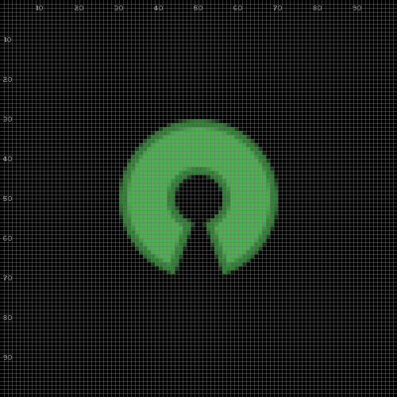
</td></tr>
</table>

*(The [image](../c/res/open.png) is part of the repository.)*

For images, we can omit both width `w` and height `h` to preserve original
dimensions and aspect ratio.

`pico-atmos` also supports pixmaps, which are custom arrays of colored pixels:

<table>
<tr><td><pre>
pico.output.clear()
val _ = 'black'
val o = 'blue'
val x = 'silver'
val PI = [
    [_,_,_,o,o,o,o,_,_,_],
    [_,o,o,o,o,o,o,o,o,_],
    [_,o,x,x,x,x,x,x,o,_],
    [o,o,o,x,o,o,x,o,o,o],
    [o,o,o,x,o,o,x,o,o,o],
    [o,o,o,x,o,o,x,o,o,o],
    [o,o,o,x,o,o,x,o,o,o],
    [_,o,o,x,o,o,x,o,o,_],
    [_,o,o,o,o,o,o,o,o,_],
    [_,_,_,o,o,o,o,_,_,_],
]
val pi = pico.layer.pixmap [ pixels=PI ]
pico.output.draw.layer(pi, ['!', x=50, y=50, w=80])
</pre>
</td><td>
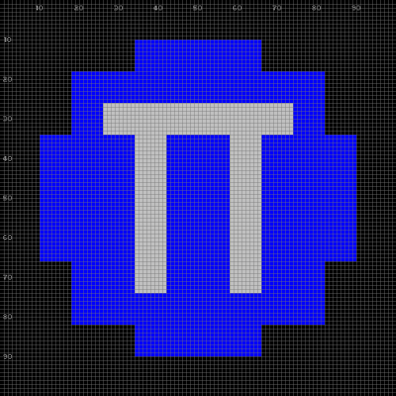
</td></tr>
</table>

The table `PI` determines the color of each pixel to draw.
We use single-char color variables to initialize the pixmap array:
the "Greek letter PI", on top of a blue circle, on top of a black background.

Note that a pixmap takes two steps: `pico.layer.pixmap` creates a layer with
the pixels, which we hold in the variable `pi`, and `pico.output.draw.layer`
draws it.

Internally, `pico-atmos` keeps the texts, images and fonts that we pass as
strings, such that they are reused on subsequent redraws.
We detail layers and their memory in [#Layers](#7-layers).

## 4. Positioning: Modes & Anchors

In `pico-atmos`, we describe positions, dimensions, and shapes using standard
Atmos tables with named fields (e.g., `w` for width).
In addition to the usual fields, tables also describe
    a **mode** at index `0`, and
    an **anchor** at field `anchor`:

- `[ '%', x=0.5, y=0.5 ]`:          a centered relative position
- `[ '!', w=20, h=30 ]`:            a raw dimension
- `[ '#', x=4, y=4, w=2, h=1 ]`:    a rectangle spanning 2 tiles horizontally
- `[ '%', x=0, y=1, anchor='SW' ]`: a bottom-left position with *southwest* anchor

The **mode** determines the behavior of coordinates within layers:

- `'!'` - Raw: coordinates are in pixels
- `'%'` - Percentage: coordinates are relative to layer dimensions
- `'#'` - Tile: coordinates are based on tile indices

Note that the percentage mode `'%'` is independent of layer dimensions and
adapts naturally to resizes.

The mode is mandatory: a position, dimension, or rectangle with no mode is an
error.

The **anchor** determines the reference point **within** shapes:

```
+-----------+
|NW   N   NE|
| W   C   E |
|SW   S   SE|
+-----------+
```

When drawing, the anchor pins an inner shape position to the given coordinate.
As shown in the previous examples, by default, `pico-atmos` uses the center
anchor `'C'`.

Let's draw a pixel and three rectangles, all at the same position, but using
different anchors:

<table>
<tr><td><pre>
pico.close() ; pico.open()
pico.set.pencil [ color='white' ]
pico.output.draw.pixel [ '%', x=0.5, y=0.5 ]
pico.set.pencil [ color=pico.color.alpha('red',   0x80) ]
pico.output.draw.rect [ '%', x=0.5, y=0.5, w=0.3, h=0.3, anchor='NW' ]
pico.set.pencil [ color=pico.color.alpha('green', 0x80) ]
pico.output.draw.rect [ '%', x=0.5, y=0.5, w=0.3, h=0.3, anchor='C' ]
pico.set.pencil [ color=pico.color.alpha('blue',  0x80) ]
pico.output.draw.rect [ '%', x=0.5, y=0.5, w=0.3, h=0.3, anchor='SE' ]
</pre>
</td><td>
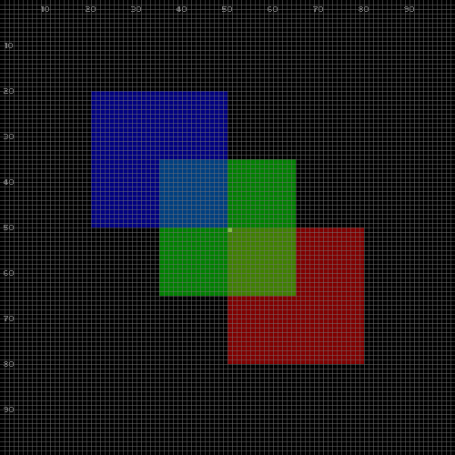
</td></tr>
</table>

The pixel represents the reference position `%(0.5,0.5)` used by the three
rectangles.
The alpha `0x80` makes the overlapping regions reveal how the pinned anchors
offset each rectangle from the same coordinate:

- the **red** rectangle places its `NW` corner at `(0.5,0.5)`
- the **green** one places its center `C` there
- the **blue** one places its `SE` corner there

### 4.1. Tiles

The tile mode `'#'` uses discrete sized blocks as references for positions and
dimensions:

<table>
<tr><td><pre>
pico.close() ; pico.open()
pico.set.scene [
    tile = [ '!', w=20, h=20 ], ;; tile size (20x20 px)
    dim  = [ '#', w=5, h=5 ],   ;; world size (5x5 tiles)
]
pico.output.draw.rect [ '#', x=3, y=3, w=1, h=1 ]
pico.output.draw.rect [ '#', x=5, y=1, w=2, h=1, anchor='NE' ]
</pre>
</td><td>
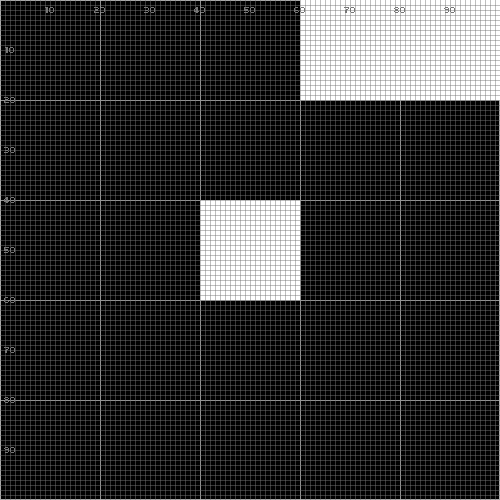
</td></tr>
</table>

In the example, we set each tile to `20x20` and create a world of `5x5` tiles.

Then, we draw two rectangles using the tile mode `'#'`:

- The first is centered at `(3,3)` occupying `1x1` tile (`20x20` logical pixels).
- The second uses anchor `NE`, to properly occupy the top right of the screen
  with `2x1` tiles (`40x20` logical pixels).

## 5. Advanced Views

The scene view controls how the logical world maps to the physical window.

Next, we discuss some advanced properties for `pico.set.scene`:

| Property | Description             |
|----------|-------------------------|
| `target` | world to window mapping |
| `source` | visible world region    |
| `clip`   | world clipping region   |

The `target` property controls where the world is rendered within the physical
window:

<table>
<tr><td><pre>
pico.close() ; pico.open()
pico.output.draw.image('../c/res/open.png',
    ['%', x=0.5, y=0.5, w=0.5, h=0.5])
pico.set.scene [
    target = ['%', x=0.8, y=0.8, w=0.3, h=0.2],
]
</pre>
</td><td>
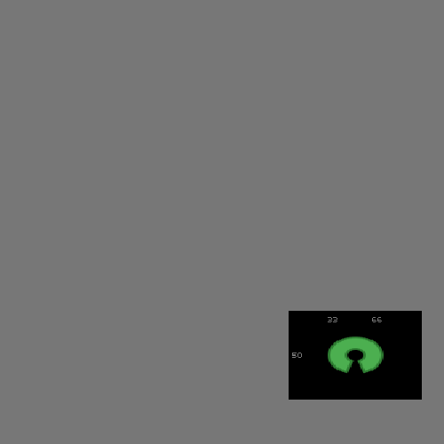
</td></tr>
</table>

Note how the world moves to fit a smaller target window at the bottom-right of
the screen, with a slight distortion, since the new `w/h` changes the aspect
ratio.

The `source` property selects which region of the world is visible:

<table>
<tr><td><pre>
pico.set.scene [
    source = ['%', x=0.5, y=0.5, w=0.4, h=0.4],
]
</pre>
</td><td>
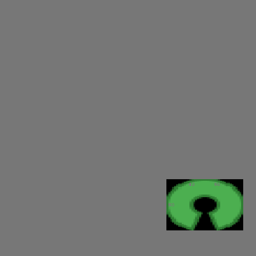
</td></tr>
</table>

We now crop a small piece (`40%`) of the world from its center.
The visual effect is to zoom in the image, since we stretch out the cropped
world into the same target.

The `clip` property restricts the effect of drawing operations into a
sub-region of the world:

<table>
<tr><td><pre>
pico.close() ; pico.open()
pico.set.scene [
    clip = ['%', x=0.5, y=0.5, w=0.25, h=0.25],
]
pico.output.draw.image('../c/res/open.png',
    ['%', x=0.5, y=0.5, w=0.5, h=0.5])
</pre>
</td><td>
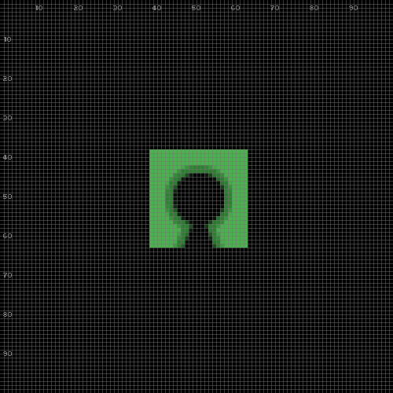
</td></tr>
</table>

We restrict drawing operations to a small region (`25%`) in the center of the
world.
Then, we draw the image centered, which is clipped to fit the specified area.

### 5.1. Zoom & Scroll

We can manipulate the `source` view property to implement not only zooming, as
illustrated above, but also scrolling effects.

Let's restart with a centered image over a black window background (to match
the world background when we zoom out):

<table>
<tr><td><pre>
pico.close() ; pico.open()
pico.set.layer(pico.layer.window()) ;; (typically grey to distinguish from world)
pico.set.effect [ color='black' ]
pico.set.layer(pico.layer.world())
pico.output.draw.image('../c/res/open.png',
    ['%', x=0.5, y=0.5, w=0.5, h=0.5])
</pre>
</td><td>

</td></tr>
</table>

Next, we crop the view in half (`w=h=0.5`) to get a `2x` zoom in:

<table>
<tr><td><pre>
pico.set.scene [
    source = ['%', x=0.5, y=0.5, w=0.5, h=0.5],
]
</pre>
</td><td>
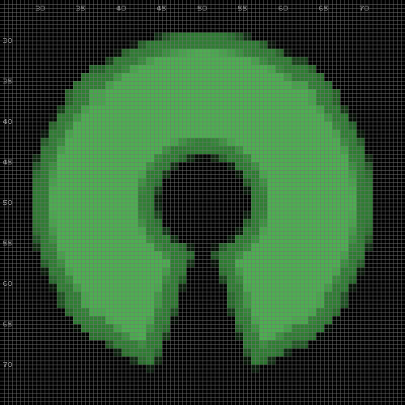
</td></tr>
</table>

Likewise, when we double the source (`w=h=2`), we get a `1/2` zoom out:

<table>
<tr><td><pre>
pico.set.scene [
    source = ['%', x=0.5, y=0.5, w=2, h=2],
]
</pre>
</td><td>
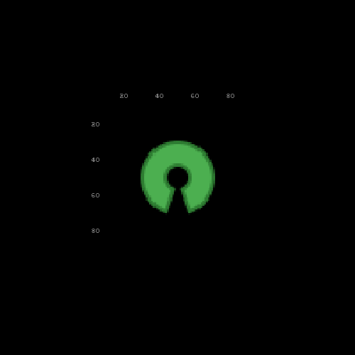
</td></tr>
</table>

We can apply the same reasoning to create a scroll effect when we manipulate
the source `x` and `y` fields:

<table>
<tr><td><pre>
pico.set.scene [
    source = ['%', x=0.8, y=0.2, w=2, h=2],
]
</pre>
</td><td>
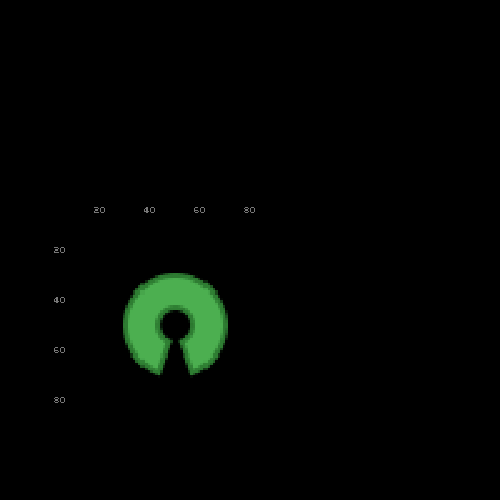
</td></tr>
</table>

A positive `x=+0.3` offset (from `0.5` to `0.8`) crops the left side of the
source, which still targets the whole window, resulting in a scroll left.

A negative `y=-0.3` offset (from `0.5` to `0.2`) crops the bottom of the
source, resulting in a scroll down.

## 6. Events

In addition to output and drawing operations, `pico-atmos` also provides
functions to handle time and user input.

### 6.1. Delay

A call to `pico.input.delay(ms)` pauses execution for the specified time:

<table>
<tr><td><pre>
pico.close() ; pico.open()
pico.output.draw.pixel [ '%', x=0.25, y=0.5 ]
pico.input.delay(1000)
pico.output.draw.pixel [ '%', x=0.50, y=0.5 ]
pico.input.delay(1000)
pico.output.draw.pixel [ '%', x=0.75, y=0.5 ]
</pre>
</td><td>
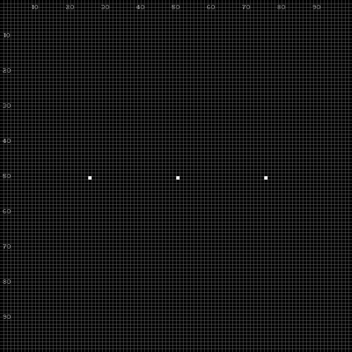
</td></tr>
</table>

After each drawing, we pause execution for `1s`, also blocking (freezing) the
program.

Combined with loops, delays can create non-interactive animations.

Here, we draw a circle pixel by pixel:

<table>
<tr><td><pre>
pico.output.clear()
loop i in (1,400) {
    val rad = i * math.pi / 180
    pico.output.draw.pixel [ '%',
        x = 0.5 + 0.3*math.cos(rad),
        y = 0.5 + 0.3*math.sin(rad),
    ]
    pico.input.delay(10)
}
</pre>
</td><td>
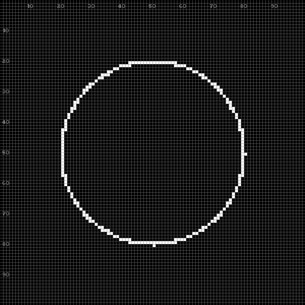
</td></tr>
</table>

On each step, we draw a single pixel and delay execution for a short period.

### 6.2. Event

To create interactive applications, we use `pico.input.event` to wait for input
events.

Let's create a simple loop to explore the possibilities:

```
loop {
    val e,ms = pico.input.event()
    print("EVENT", ms, e.tag)
    loop k,v in e {
        print('', k, v)
    }
    if e.tag=='key.dn' && e.key=='Escape' {
        break
    }
}
```

The call to `pico.input.event` returns two values:

- `e` is a table with a `tag` field that identifies the event type
- `ms` is the time elapsed between two event occurrences

You may interact with the window by pressing keys, using the mouse, resizing
the window, and so on.
To escape the loop, press the `Escape` key.
Note that, by default, closing the window terminates the program immediately.

Event types (*tags*) include `'key.dn'`, `'mouse.button.dn'`,
`'mouse.motion'`, and many others.
Since an event is a tagged table, we can also test it with the operator `??`,
as in `e ?? :key.dn`.

We can filter events and set timeouts:

```
val e1 = pico.input.event('key.dn')         ;; wait for key press only
val e2 = pico.input.event('key.dn', 5000)   ;; wait key up to 5000ms
```

When a timeout expires without an event, `nil` is returned:

```
print(e2)   ;; nil, after 5000 if no keys pressed
```

### 6.3. Default Key Bindings

By default, `pico-atmos` provides key bindings to zoom and scroll the current
view:

- `CTRL` / `+`,`-`: zoom in / out
- `CTRL` / Arrow keys: scroll left / right / up / down
- `CTRL` / `g`: show / hide the grid
- `CTRL` / `s`: save a screenshot of the window

Let's draw a centered image and use the key bindings to explore it:

<table>
<tr><td><pre>
pico.close() ; pico.open()
pico.output.draw.image('../c/res/open.png',
    ['%', x=0.5, y=0.5, w=0.5, h=0.5])
pico.input.loop()
</pre>
</td><td>
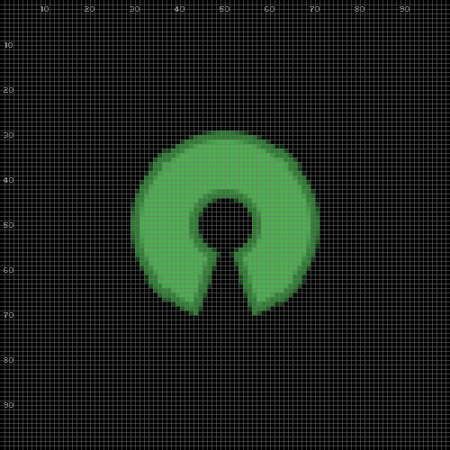
</td></tr>
</table>

The call to `pico.input.loop()` passes full control to `pico-atmos` to handle
events internally.

Now, try `CTRL` pressing `+` to zoom in and the arrow keys to scroll around.
Finally, close the window (e.g., `ALT+F4`) to escape from the loop.

## 7. Layers

Layers are independent views, in which you can draw shapes separately, and
then compose them to form complex scenes.

The main logical world is itself a layer, as well as images, texts, pixmaps,
and videos.
Calls like `pico.output.draw.image(path,rect)` internally create a layer and
keep it by its path, so repeated calls reuse it.
Therefore, all discussed [#view properties](#5-advanced-views) also apply to
layers.

### 7.1. Creating Layers

We use `pico.layer.empty` to create a fresh layer, and `pico.set.layer` to
redirect further drawing operations to it:

```
pico.close() ; pico.open()
val flag = pico.layer.empty [ dim=['!', w=300, h=200] ]
pico.set.layer(flag)
pico.set.pencil [ color=[ r=0x00, g=0x2B, b=0x7F ] ]
pico.output.draw.rect [ '%', x=0.00, y=0.0, w=0.33, h=1.0, anchor='NW' ]
pico.set.pencil [ color=[ r=0xFC, g=0xD1, b=0x16 ] ]
pico.output.draw.rect [ '%', x=0.33, y=0.0, w=0.34, h=1.0, anchor='NW' ]
pico.set.pencil [ color=[ r=0xCE, g=0x11, b=0x26 ] ]
pico.output.draw.rect [ '%', x=0.67, y=0.0, w=0.33, h=1.0, anchor='NW' ]
```

At this point, nothing appears on the screen yet, since we did not update the
main world view.

We first hold the new layer in the variable `flag` and set it as the current
drawing layer.
Then, we paint shapes inside it with the chosen colors.

A layer is a value, like a table or a function: `pico.layer.empty` evaluates
to the new layer, and every operation on layers receives such a value.
There are no layer names.

**A layer lives as long as its value is referenced.**
When the last reference to a layer goes away (e.g., its variable goes out of
scope, or is assigned another value), `pico-atmos` releases the layer.
A plain `val` is enough to keep a layer alive.
This rule has an important consequence, which we revisit in
[#Hierarchy](#74-hierarchy): a layer that we attach to the screen must still
be kept in a variable, otherwise it is released and disappears.
We detail the rules in [#Memory and Lifetimes](#75-memory-and-lifetimes).

### 7.2. Compositing

To compose a layer on top of the current layer, we call
`pico.output.draw.layer`:

<table>
<tr><td><pre>
pico.set.layer(pico.layer.world())  ;; back to the world layer
pico.output.draw.layer(flag, ['%', x=0.33, y=0.33, w=0.2])
pico.output.draw.layer(flag, ['%', x=0.66, y=0.66, w=0.5])
</pre>
</td><td>
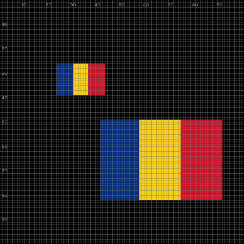
</td></tr>
</table>

We first use `pico.set.layer(pico.layer.world())` to target the world layer.
Then, we compose the flag twice, with different arguments.

We can also flip and rotate layers when compositing them, by setting their
`pico.set.effect` fields:

<table>
<tr><td><pre>
pico.set.layer(flag)
pico.set.effect [
    flip   = 'horizontal',
    rotate = [angle=30, anchor='C'],
]
pico.set.layer(pico.layer.world())
pico.output.clear()
pico.output.draw.layer(flag, ['%', x=0.75, y=0.25, w=0.3])
</pre>
</td><td>
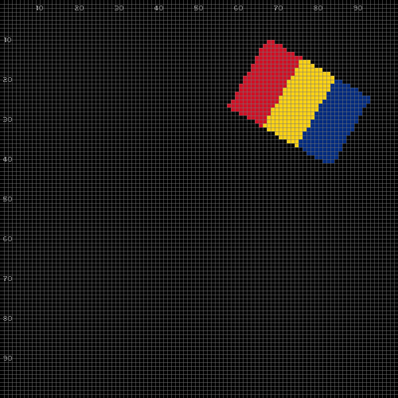
</td></tr>
</table>

In the example, the `flip` field receives `horizontal` to reverse the stripe
order.
The `rotate` table takes an `angle` in degrees and an `anchor` for the pivot
point.

We can also set the transparency of a layer by lowering its `alpha` field:

<table>
<tr><td><pre>
pico.set.layer(flag)
pico.set.effect [
    rotate = [angle=0],
    flip   = 'none',
    alpha  = 0x80,
]
pico.set.layer(pico.layer.world())
pico.output.draw.layer(flag, ['%', x=0.5, y=0.5, w=0.6])
</pre>
</td><td>
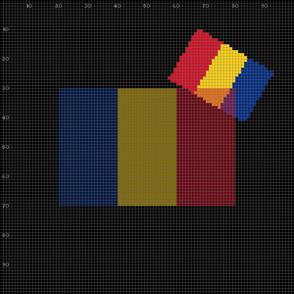
</td></tr>
</table>

This time we do not clear the screen, such that the previous flag remains
visible behind the new one.

Following the general conventions for alpha,
    `0x00` is fully transparent, while
    `0xFF` is fully opaque.

### 7.3. Sub-Layers

A sub-layer points to a region within a source layer, with both sharing the
actual pixel contents.

Sub-layers are useful to isolate individual frames from sprite sheets in games,
which we discuss in [#Animations](#83-animations).

We call `pico.layer.sub` to crop a region of a source layer.
In the next example, we want to isolate each stripe of the flag as a sub layer:

<table>
<tr><td><pre>
val blue   = pico.layer.sub [ sup=flag, crop=['%', x=0.25, y=0.5, w=0.1, h=0.15] ]
val yellow = pico.layer.sub [ sup=flag, crop=['%', x=0.50, y=0.5, w=0.1, h=0.15] ]
val red    = pico.layer.sub [ sup=flag, crop=['%', x=0.75, y=0.5, w=0.1, h=0.15] ]
pico.output.clear()
pico.output.draw.layer(blue,   ['%', x=0.30, y=0.30, w=0.25])
pico.output.draw.layer(yellow, ['%', x=0.70, y=0.45, w=0.25])
pico.output.draw.layer(red,    ['%', x=0.45, y=0.75, w=0.25])
</pre>
</td><td>
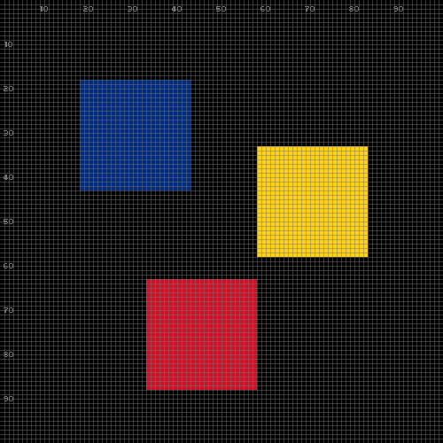
</td></tr>
</table>

Each sub-layer crops a square from each stripe of the flag (blue, yellow, red),
and then draws each on the screen.

A sub-layer uses the same APIs as layers.
For instance, the variables `blue`, `yellow`, and `red` hold the sub-layers for
further operations.

A sub-layer depends on its source: the flag is only released after its three
sub-layers, even if the variable `flag` goes away first.

### 7.4. Hierarchy

Layers in `pico-atmos` can form a tree hierarchy which `pico.output.present`
traverses automatically to compose the full scene onto the screen.

When creating a new layer, we can pass an `up` layer to become its parent:

```
;; (this is just a sketch - do not execute)
val me = pico.layer.empty [ up=up, ... ]    ;; `up` is parent of `me`
pico.set.layer(me)                          ;; setup `me`
pico.set.scene [                            ;; position `me` within `up`
    target = ['%', x=0.5, y=0.5, w=0.5, h=0.5]
]
```

After we create the layer, we set the target region within its parent.
In the example, the child layer `me` is centered inside parent layer `up`.

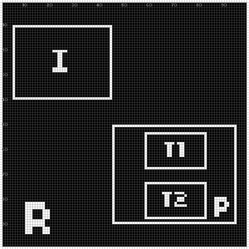

As an example, suppose we want to draw the layout in the figure in the right:
The world layer (shown as `R` in the figure) contains the image layer `I`
and panel layer `P`, which contains the text layers `T1` and `T2`.

The next code listing implements this layout:

- `I`: created with `pico.layer.image` with the world as parent
- `P`: created with `pico.layer.empty` with the world as parent
    - `T1`: created with `pico.layer.text` with `P` as parent
    - `T2`: created with `pico.layer.text` with `P` as parent

<table>
<tr><td><pre>
pico.close() ; pico.open()
val pic = pico.layer.image [        ;; image at top-left
    up=pico.layer.world(), path="../c/res/open.png",
    target=['%', x=0.3, y=0.3, w=0.4],
]
                                    ;; panel at bottom-right
val panel = pico.layer.empty [
    up=pico.layer.world(), clear=true, dim=['!', w=100, h=50],
]
pico.set.layer(panel)
pico.set.effect [ color='silver' ]
pico.set.scene [ target = ['%', x=0.7, y=0.7, w=0.4] ]
val H = pico.layer.text [
    up=panel, dim=['!', h=20], text="Hello",
    target=['%', x=0.5, y=0.3, h=0.6],
]
val W = pico.layer.text [
    up=panel, dim=['!', h=20], text="World!",
    target=['%', x=0.5, y=0.7, h=0.4],
]
pico.set.layer(pico.layer.world())
pico.output.present()
</pre>
</td><td>
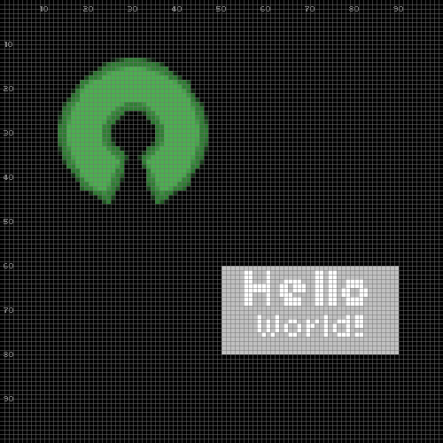
</td></tr>
</table>

After the scene is composed, we simply call `pico.output.present` to
update the screen all at once.

Note that we keep all four layers in variables (`pic`, `panel`, `H`, `W`),
even though we only use `panel` afterwards.
A layer that is dropped disappears from the screen: if we called
`pico.layer.image [...]` without the `val pic =`, the image would be released
immediately, and would not show up.

The opposite direction is automatic: a parent is kept alive by its children.
The layer `panel` would survive without its variable, as long as `H` or `W`
are alive.

### 7.5. Memory and Lifetimes

Layers, fonts, and sounds are memory resources that require a mechanism for
consistent allocations and matching deallocations.

In `pico-atmos`, these resources are values of the language, and follow its
memory management: **a resource is released when its value is no longer
referenced**.
There are no explicit scopes to open and close.

In more detail, a resource is released in one of three ways:

1. With its last reference, when no variable or table holds its value.
2. With the block in which it is pinned, if it is declared with `pin` instead
   of `val`.
3. With an explicit call to `pico.layer.free(l)`, `pico.font.free(f)`, or
   `pico.sound.free(s)`, after which any use of the value raises an error.

What a resource depends on outlives it:
    the parent of a layer (`up`),
    the source of a sub-layer (`sup`),
    the current layer (`pico.set.layer`), and
    the font of a pencil.
If such a value is dropped, or pinned in a block that terminates first, its
release is postponed until nothing depends on it.
For the same reason, the explicit `free` of a resource in use raises an error.

A `pin` requires extra care.
Like any pinned value in Atmos, a pinned resource cannot be stored in a table,
unless the table is also pinned.
This includes the tables that we pass as arguments, as in `[sup=l]`:

```
do {
    pin l = pico.layer.empty [ dim=['!', w=32, h=32] ]
    pin t = [ sup=l, crop=['%', x=0.5, y=0.5, w=0.5, h=0.5] ]
    val s = pico.layer.sub(t)
    ;; (a direct `pico.layer.sub [ sup=l, ... ]` raises
    ;;  `invalid escape : pinned value`)
}   ;; `l` and `t` are reclaimed here
```

In general, a plain `val` is simpler and enough to hold a resource.

Finally, `pico.close()` releases all resources at once.
The values from before the call become invalid, even after a new `pico.open()`,
and any use of them raises an error.
This includes the values of `pico.layer.world()` and `pico.layer.window()`,
which we must evaluate again.

As the next example illustrates, lifetimes are convenient for applications that
move through long sequences of scenes (e.g., menu `->` game `->` game-over
`->` ...):

<table>
<tr><td><pre>
pico.close() ; pico.open()
loop i in (1,5) {
    pico.output.clear()
    pico.output.draw.text(i, ['%', x=0.5, y=0.5, h=0.7])
    pico.input.delay(500)
}
</pre>
</td><td>
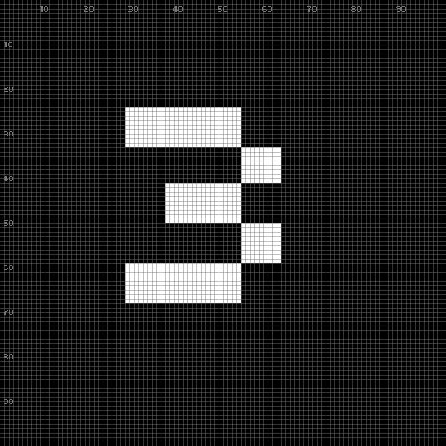
</td></tr>
</table>

*(The image shows the third iteration.)*

In the example, the loop represents a continuous, possibly infinite, sequence
of scenes, each with its own text.

However, `pico.output.draw.text` allocates implicitly: like for images,
`pico-atmos` keeps a texture for each distinct text until `pico.close()`.
This is fine for constant texts, but not for texts that keep changing, such as
clocks and counters, which would accumulate over time.

In these cases, each scene should hold its own layers in local variables, which
are released when the scene terminates:

```
loop i in (1,5) {
    val txt = pico.layer.text [ dim=['!', h=70], text=i ]
    pico.output.clear()
    pico.output.draw.layer(txt, ['%', x=0.5, y=0.5, h=0.7])
    pico.input.delay(500)
}   ;; releases `txt` at the end of each iteration
```

Since the variable `txt` is local to the body of the loop, each text layer is
released before the next one is created.
Lifetimes not only keep the memory footprint constant over time, but also help
to organise and reason about the application memory.

## 8. Expert Mode

By default, as seen in previous sections, each drawing operation becomes
immediately visible on the screen.

However, to keep visual objects in perfect sync, most games and non-trivial
applications require to draw them all simultaneously on every frame.

For this reason, `pico-atmos` supports an expert mode that buffers drawing
operations until an explicit call to `pico.output.present`, which updates the
screen with all objects at once:

To enable the expert mode, we call `pico.set.expert`:

<table>
<tr><td><pre>
pico.close() ; pico.open()
pico.set.expert(true)
pico.output.draw.rect [ '%', x=0.33, y=0.33, w=0.4, h=0.4 ]
pico.input.delay(1000)  ;; artificial delay
pico.output.draw.rect [ '%', x=0.66, y=0.66, w=0.4, h=0.4 ]
pico.input.delay(1000)  ;; artificial delay
</pre>
</td><td>

</td></tr>
</table>

Note that although the code above takes `2s` to complete, nothing appears on
the screen, since we have not called `pico.output.present` yet:

<table>
<tr><td><pre>
pico.output.present()
</pre>
</td><td>
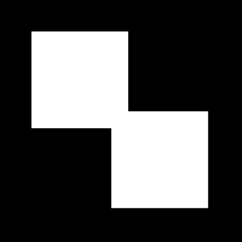
</td></tr>
</table>

Now, both the rectangles appear at the same time.

### 8.1. Application Main Loop

Typical games and graphical applications need to deal continually with moving
objects, input from users, and also the passage of time.
These applications follow the structure of a continuous "main loop":
    poll user events,
    update the state of objects,
    redraw the whole scene (a frame), and
    repeat at a given *FPS rate* (frames per second).

This is what a main loop in `pico-atmos` looks like:

```
;; (this is just a sketch - do not execute)

pico.set.expert(true, 40)           ;; 40 FPS

loop {                              ;; main loop
    pico.output.clear()
    pico.output.*()                 ;; scene redrawing
    pico.output.present()

    val e,dt = pico.input.event()   ;; event / timeout awaiting

    if e {
        (normal atmos code)         ;; event handler (keys, mouse)
    } else {
        (normal atmos code)         ;; timeout handler (animations, collisions)
    }
}
```

The call to `pico.set.expert` serves two purposes:

1. Disables automatic screen update that would happen after every single draw
    call.
    Now, all redrawing between successive calls to `present` appears as a
    single frame.
    Even with hundreds of objects, the screen update is instantaneous.

2. Sets the FPS rate to `40`, making `pico.input.event` awake every `25ms`.
    If an event occurs in the meantime, say after `10ms`, then `e` is set and
    the next call to `pico.input.event` resumes after only `15ms` (`25-10`).

If the `FPS` argument is omitted, `pico.input.event` only awakes from events,
but never from timeouts.

In expert mode, closing the window no longer terminates the program: it
becomes a `'quit'` event, which the main loop must handle.

### 8.2. A Simple Example

The next example tracks the position of two pixels on a `10x10` screen:

- one follows the mouse, wherever it moves to;
- the other responds to the arrow keys.

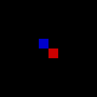

The complete source code is [here](rects.atm) (`~50` lines of code).

Run the program:

```
$ ../pico-atmos rects.atm
```

Now, let's discuss the implementation:

```
;; (omitted initialization - do not execute)

pico.set.expert(true)               ;; no timeouts

val k = ['!', x=4, y=4]             ;; key pixel
var m = ['!', x=5, y=5]             ;; mouse pixel

loop {                              ;; main loop
    ;; redraw scene
    pico.output.clear()
    pico.set.pencil [ color='red' ]
    pico.output.draw.pixel(m)
    pico.set.pencil [ color='blue' ]
    pico.output.draw.pixel(k)
    pico.output.present()

    ;; handle events
    val e = pico.input.event()
    assert(e, "no FPS set here")
    ifs {
        e.tag == 'quit' => {
            break
        }
        e.tag == 'mouse.motion' => {
            set m = pico.get.mouse('!')
        }
        e.tag == 'key.dn' => {
            match e.key {
                'Up'    => { set k.y = k.y - 1 }
                'Down'  => { set k.y = k.y + 1 }
                'Left'  => { set k.x = k.x - 1 }
                'Right' => { set k.x = k.x + 1 }
            }
        }
    }
}
```

Since this example does not contain time-based animations, we do not set FPS in
`pico.set.expert`, so `pico.input.event` awakes only on events.

The tables `k` and `m` represent the pixels controlled by the keyboard and
mouse, respectively.
They use the raw mode `'!'` and start at `(4,4)` and `(5,5)`.

The main loop first draws their initial positions and awaits
`pico.input.event`.
In this example, we only handle `quit`, `mouse.motion` and `key.dn` events:

- on a quit event, we escape the loop to terminate the application;
- for the mouse, we update `m` to follow `pico.get.mouse`;
- for the keyboard, we update `k.x` or `k.y` depending on `e.key`.

Then, the loop iterates to redraw the scene and wait for the next event.

### 8.3. Animations

The next example creates two time-based animations that require to set
`pico.set.expert` with FPS.

We want the characters to move along the rectangular paths, in opposite
directions, and at different speeds.
The animation in the left is based on the sprite sheet in the right:

<table>
<tr><td align="center">
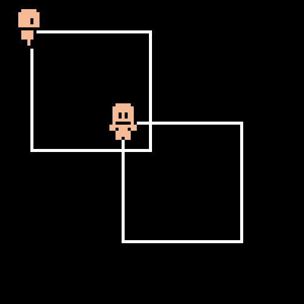
</td><td align="center">
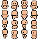
<br>
<small>
    Credits:
        <a href="https://opengameart.org/content/simple-character-base-16x16">
            OpenGameArt.org
        </a>
</small>
</td></tr>
</table>

The complete source code is [here](anims.atm) (`~90` lines of code).

Run the program:

```
$ ../pico-atmos anims.atm
```

Now, let's discuss the implementation.
The overall structure is always the same:

```
;; (omitted initialization - do not execute)

pico.set.expert(true, 20)

var f1, x1, y1 = walk('clock',   0, 0)      ;; clockwise (faster)
var f2, x2, y2 = walk('counter', 0, 0)      ;; counter clockwise

var t = 0

loop {                                      ;; main loop
    ;; redraw the scene
    pico.output.clear()
    pico.output.draw.rect [
        '%', x=0.3, y=0.3, w=0.4, h=0.4     ;; rect path (top-left)
    ]
    pico.output.draw.rect [
        '%', x=0.6, y=0.6, w=0.4, h=0.4     ;; rect path (bottom-right)
    ]
    pico.output.draw.layer(
        f1, ['%', x=x1, y=y1, w=0.15]       ;; clockwise sprite
    )
    pico.output.draw.layer(
        f2, ['%', x=x2, y=y2, w=0.15]       ;; counter sprite
    )
    pico.output.present()

    ;; handle events
    val e, dt = pico.input.event('quit')
    if e {
        break
    }

    set t = t + dt                          ;; handle animations
    set f1, x1, y1 = walk('clock',   t*2, t)
    set f2, x2, y2 = walk('counter', t,   t)
}
```

Now, we set FPS to `20` to animate the sprites every `50ms`.

The function `walk` (see the full source) receives a clock direction and the
elapsed time, returning the sprite and positions to apply.

The main loop redraws the whole scene (rectangle paths and sprites) and awaits
the next clock tick.
In this example, `pico.input.event` either awakes from a `'quit'` event, which
escapes the main loop, or after `50ms`, which applies the next animation step.

In the omitted initialization, we use [#sub-layers](#73-sub-layers) to crop the
`4x4` sprite sheet above:

```
val frames = pico.layer.images [
    path="img/walk.png", sheet=['#', w=4, h=4],
]

val dirs = [
    down  = [ 0,  1,  2,  3],   ;; frames@0 -> frames@3
    up    = [ 4,  5,  6,  7],
    right = [ 8,  9, 10, 11],
    left  = [12, 13, 14, 15],
]
```

This splits the sprite sheet into a vector with the layers `frames@0` to
`frames@15`:
walk down (`0-3`), up (`4-7`), right (`8-11`), left (`12-15`).

Then, at each loop step, the call to `walk` decodes the current state and
returns the appropriate layer of `frames`.

### 8.4. Reactive Mode

The main loops of the previous sections all have the same structure, which
`pico-atmos` can also provide by itself.

Atmos is a reactive language, in which tasks `await` events.
When the main body of a program awaits while `pico-atmos` is open, the
program runs inside the main loop of `pico-atmos`, which emits the events to
the program.
On each frame, the loop emits, in this order:

1. the time elapsed since the previous frame, which awakes timers such as
   `await 1s` and `loop on 100ms`;
2. an input event, if any, such as `:key.dn`, `:mouse.motion`, or `:quit`;
3. the event `:draw`, between a clear and a present, for the program to redraw
   the screen.

The loop runs in expert mode, at `30` FPS by default, or at the rate that the
program sets with `pico.set.expert(true,fps)`.

The next example moves a square from left to right:

```
include "../pico.atm"

pico.open()

var x = 0

par :any {
    loop on :draw {                     ;; redraws every frame
        pico.output.draw.rect [ '!', x=x, y=50, w=10, h=10 ]
    }
} with {
    loop on 100ms {                     ;; moves 10 times per second
        set x = (x + 1) % 100
    }
} with {
    await :key.dn [ key='Escape' ]      ;; terminates the program
}

pico.close()
```

The program has no main loop, no `clear`, no `present`, and no call to
`pico.input.*`.
Instead, the three lines of execution of the `par :any` run concurrently:

- The first redraws the square on every `:draw`.
- The second awakes every `100ms` to update the position of the square.
- The third awaits the key `Escape`.
  When it terminates, the `par :any` aborts the other two, the program
  reaches its end, and so does the loop of `pico-atmos`.

The loop also terminates when we close the window: it emits `:quit` and then
aborts the program.

An input event is a tagged table with the same fields of the events of
[`pico.input.event`](#62-event).
As an example, this is how the main loop of the two pixels of
[#A Simple Example](#82-a-simple-example) becomes in reactive mode:

```
;; (omitted initialization - do not execute)

par {
    loop on :draw {
        pico.set.pencil [ color='red' ]
        pico.output.draw.pixel(m)
        pico.set.pencil [ color='blue' ]
        pico.output.draw.pixel(k)
    }
} with {
    loop on :mouse.motion {
        set m = pico.get.mouse('!')
    }
} with {
    loop e on :key.dn {
        match e.key {
            'Up'    => { set k.y = k.y - 1 }
            'Down'  => { set k.y = k.y + 1 }
            'Left'  => { set k.x = k.x - 1 }
            'Right' => { set k.x = k.x + 1 }
        }
    }
}
```

Each concern of the program (drawing, mouse, keyboard) becomes an independent
line of execution.
A plain `par` never terminates, so this program only terminates with `:quit`.

The [API](api.md#reactive-mode) lists all events of the reactive mode.

## 9. Auxiliary Functions

### 9.1. Coordinate Conversions

The set of `pico.cv.*` functions converts coordinates between modes and between
layers:

```
val pos = pico.cv.pos('!', ['%', x=0.5, y=0.5])
print(pos.x, pos.y)     ;; --> 50.0    50.0
```

Here, we convert a percentage into raw coordinates, assuming the default
`100x100` world layer.

Optional layer arguments can project across frames:

```
val r = pico.cv.rect (
    pico.layer.world(), '%',
    pico.layer.window(), ['!', x=250, y=250, w=100, h=100]
)
print(r.x, r.y, r.w, r.h)   ;; --> 0.5     0.5     0.2     0.2
```

Here we project a `100x100` rectangle centered in the `500x500` window,
obtaining a centered-`20%` world rectangle.
*(The actual output shows `0.2` with the rounding error of a single-precision
number, as `0.20000000298023`.)*

`pico.cv.dim` projects dimensions in the same way, without a position
component:

```
val d = pico.cv.dim (
    pico.layer.world(), '!',
    pico.layer.window(), ['!', w=100, h=100]
)
print(d.w, d.h)     ;; --> 20.0    20.0
```

### 9.2. Collision Detection

The set of `pico.vs.*` functions tests overlaps between points and rectangles:

```
print(pico.vs.pos.rect (
    ['%', x=0.55, y=0.75],
    ['!', x=50, y=50, w=20, h=20]
))                  ;; --> false
```

Here, the point at `(55,75)` of the world falls outside the rectangle, which
spans `(40,40)` to `(60,60)`.

Optional layer arguments can test across frames.
When a rect side is omitted, it defaults to that layer's bounds:

```
print(pico.vs.rect.rect (
    pico.layer.world(),
    pico.layer.window(), ['%', x=0.5, y=0.5, w=0.5, h=0.5]
))                  ;; --> true
```

Here, we compare the whole world with a centered `50%` region of the window,
which must overlap since the world is inside the window by default.

For the sake of completion, `pico-atmos` also provides `pico.vs.pos.pos` and
`pico.vs.rect.pos`.

### 9.3. Nesting Rects

The set of `pico.in.*` functions composes a child onto a parent rect,
returning a new flat value re-expressed in the current scene:

```
val p = pico.in.pos (
    ['%', x=0.5, y=0.5, w=0.5, h=0.5],  ;; parent
    ['%', x=0, y=1]                     ;; child
)
print(p.x, p.y)     ;; --> 0.255   0.755   (rounded)
```

Here, the parent rect is centered in the world with the child point at its
south (`y=1`) west (`x=0`) boundary, resulting in a new world point at `y=0.75`
(south) and `x=0.25` (west).
The extra `0.005` is half a pixel of the world, since a point also uses the
center anchor by default.
With `anchor='NW'` in the child, the result is exactly `0.25` and `0.75`.

Nesting is useful, for instance, to check mouse collisions against shapes drawn
inside shapes inside layers.

For the sake of completion, `pico-atmos` also provides `pico.in.rect` and
`pico.in.dim`.

## 10. Extras

### 10.1. Screenshots

To save a screenshot of the current window, we call
`pico.output.screenshot`:

<table>
<tr><td><pre>
pico.close() ; pico.open()
pico.set.pencil [ color='red' ]
pico.output.draw.rect [ '%', x=0.5, y=0.5, w=0.5, h=0.5 ]
pico.output.screenshot(pico.layer.window(), "my-screenshot.png")
</pre>
</td><td>
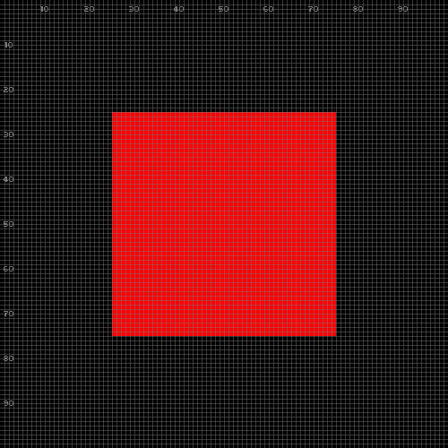
</td></tr>
</table>

The first argument is the layer to capture.
An optional rectangle crops the screenshot:

<table>
<tr><td><pre>
pico.output.screenshot (
    pico.layer.window(),
    "crop.png",
    ['%', x=0.5, y=0.5, w=0.25, h=0.25]
)
</pre>
</td><td>
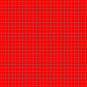
</td></tr>
</table>

We can also create a new layer from a screenshot with `pico.layer.screenshot`:

<table>
<tr><td><pre>
val snap = pico.layer.screenshot [ sup=pico.layer.window() ]
pico.output.draw.layer(snap, ['%', x=0.5, y=0.5, w=0.3])
</pre>
</td><td>
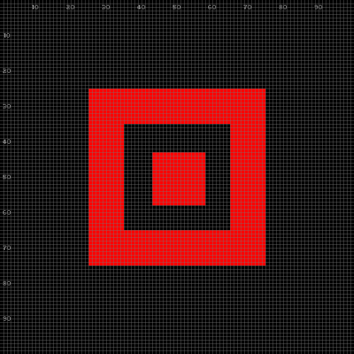
</td></tr>
</table>

In the example, we freeze the window into `snap`, then compose it back onto
the world at `30%` size.

### 10.2. Playing Sounds

To play a sound file:

```
pico.output.sound("path/to/sound.wav")
```

A sound that plays many times may also be loaded once, as a value:

```
val snd = pico.sound.load("path/to/sound.wav")
pico.output.sound(snd)
```

### 10.3. Fullscreen Mode

To enter fullscreen mode:

```
pico.set.window [ fullscreen=true ]
```

To leave fullscreen mode:

```
pico.set.window [ fullscreen=false ]
```

The current fullscreen state can be queried with `pico.get.window()`:

```
val w = pico.get.window()
print(w.fullscreen)     ;; --> false
```
